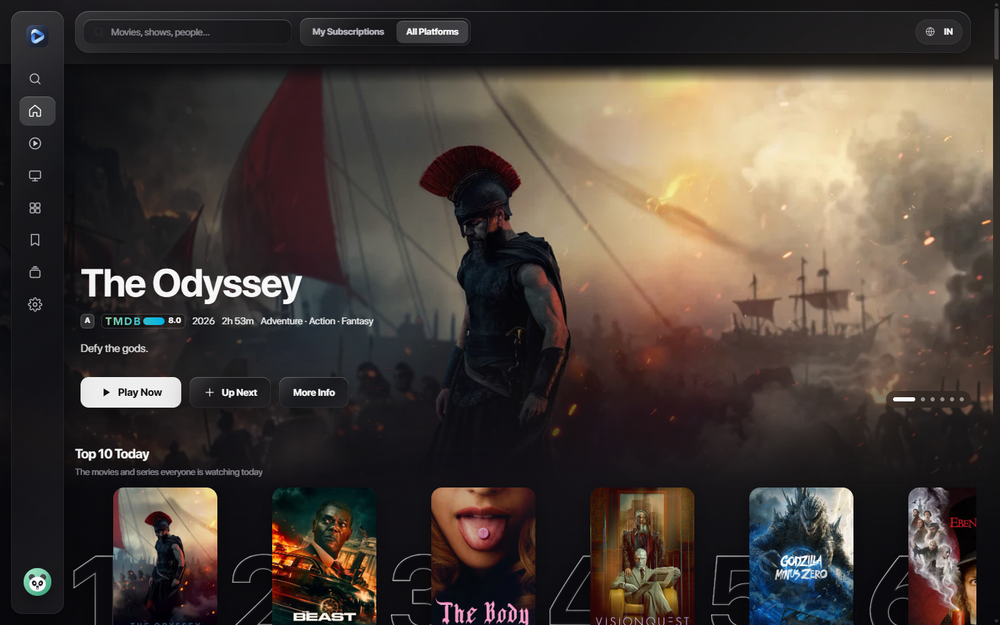
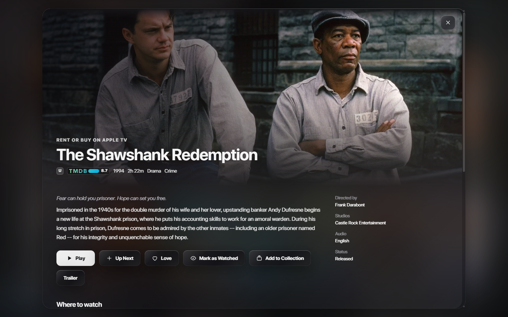
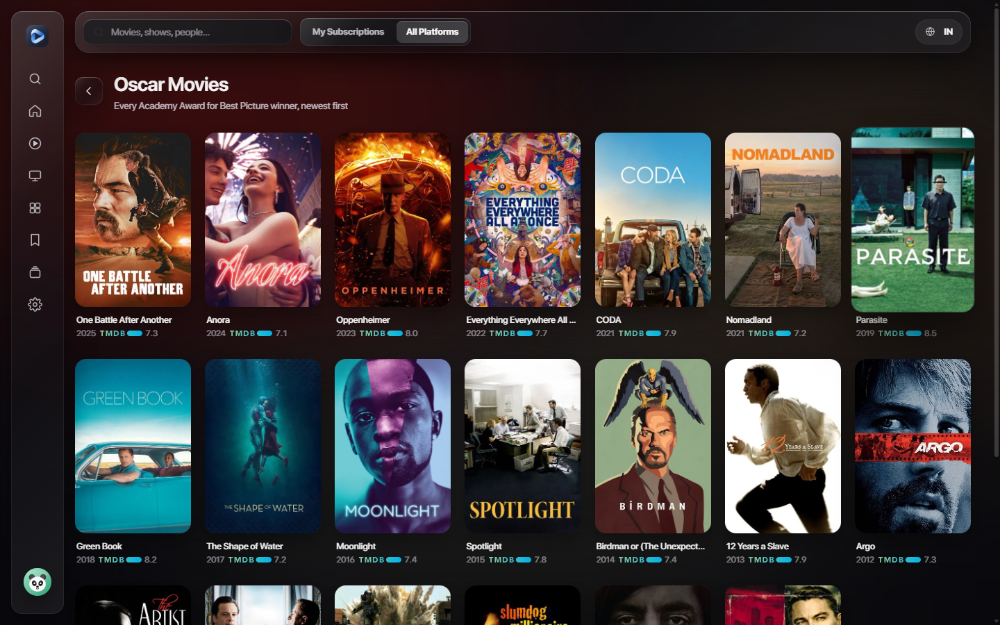

<p align="center">
  <picture>
    <source media="(prefers-color-scheme: dark)" srcset="src/assets/omnia-wordmark.png">
    <source media="(prefers-color-scheme: light)" srcset="assets/app-icon-with-text.png">
    
  </picture>
</p>

<p align="center">
  <b>Every streaming service in one hub, with a recommendation engine that never leaves your PC.</b><br>
  Netflix · Prime Video · JioHotstar · ZEE5 · Sony LIV · Apple TV+ · Disney+ · Max · Hulu · Peacock · and more
</p>

<p align="center">
  
  
  
  
  
  
  
  
</p>

<p align="center">
  
</p>

Omnia is a native Windows app that brings every streaming service into one Apple TV–style catalog. It finds where a title streams in your region, opens the **exact** page on that service in a built-in DRM-capable player, remembers your position to the second on every service, and recommends what to watch next with a machine-learning engine that runs **entirely on your machine**. Phones and TVs on your Wi-Fi can browse it too, without any cloud.

> **Privacy is the architecture, not a setting.** Profiles, watch history, taste vectors and streaming sign-ins live in a local SQLite file and WebView2's own per-profile storage. There is no Omnia server, no account, no analytics and no telemetry.

---

## Contents

- [Screenshots](#screenshots)
- [Highlights](#highlights)
- [Architecture](#architecture)
  - [Overview](#overview)
  - [React frontend](#react-frontend)
  - [Deep-link resolution](#deep-link-resolution)
  - [Smart player & telemetry](#smart-player--telemetry)
  - [ML engine: composite vectors + K-Means](#ml-engine-composite-vectors--k-means)
  - [Axum LAN companion server](#axum-lan-companion-server)
  - [Local data](#local-data)
- [Privacy model](#privacy-model)
- [Getting started (developers)](#getting-started-developers)
- [Project structure](#project-structure)
- [Development guide](#development-guide)
- [Troubleshooting](#troubleshooting)
- [Known limitations](#known-limitations)
- [License](#license)

Not a developer? See **[setup_instructions.txt](setup_instructions.txt)** for a plain-English install guide.

---

## Screenshots

| Top 10 Today & Browse by Service | IMDb Popular on Streaming (per-service filter) |
|---|---|
|  |  |
| **Title page** | **"View More" full-page grid** |
|  |  |

<p align="center">
  <br>
  <sub>The same app on a phone, served by the PC's LAN companion server</sub>
</p>

---

## Highlights

- **One catalog, your region.** TMDB-powered browsing with regional availability, a VPN-friendly region switcher and a **My Subscriptions** filter that hides anything you'd have to rent or buy.
- **A curated Home.** Continue Watching, *Top 10 Today* (released titles only), franchise hubs, *Browse by Service*, In Theatres, critic and "IMDb-style" rows, personal rows (*Because you liked…*, *Your Next Watch*, *We Think You'll Love These*) and themed rows. Global rows blend in ~30% titles from your own country. Every row lazy-loads, shows 20 titles, and ends in a **View More** grid.
- **Exact Play buttons.** Deep links to the exact title on each service, resolved through JustWatch, cached for 7 days, with a search-page fallback so Play never dead-ends.
- **A real player.** A chromeless WebView2 window (Widevine / PlayReady) with an injected observer that tracks position, pauses, seeks and in-app episode hops; a global hotkey and a glass pill take you back to the hub at the exact scroll position.
- **Cross-service history.** One-click import of past viewing (Netflix, Prime Video, JioHotstar and others) plus a background delta sync, so an episode watched on your phone's Netflix app lands in Continue Watching.
- **On-device recommendations.** Composite "vibe" vectors, K-Means taste clusters, and nearest-neighbour "More Like This" on every title page.
- **Family profiles that never mix.** Separate history, taste, kids mode and even separate streaming sign-ins per profile.
- **Phones & TVs without a cloud.** A PIN-paired LAN server on port 8765 serves the full app to any browser on your Wi-Fi; your phone can also act as a remote.

---

## Architecture

### Overview

```
┌──────────────────────────────── Omnia (Tauri 2, Windows) ────────────────────────────────┐
│                                                                                           │
│  Catalog window — React 19 + TS            Player / importer windows — WebView2           │
│  ┌────────────────────────────────┐        ┌────────────────────────────────────────┐    │
│  │ Zustand stores · TMDB client   │ events │ netflix.com / primevideo.com / …       │    │
│  │ Home row registry · Liquid     │◄───────┤ + injected telemetry observer + pill   │    │
│  │ Glass UI · lazy rows           │        │   (per-profile data directory)         │    │
│  └───────────────┬────────────────┘        └──────────────────┬─────────────────────┘    │
│                  │ typed IPC (deny-by-default ACL)             │ 5 token-gated commands  │
│  ┌───────────────▼─────────────────────────────────────────────▼─────────────────────┐   │
│  │ Rust backend                                                                       │   │
│  │  db/        SQLite (rusqlite, WAL) + numbered migrations                           │   │
│  │  resolver/  JustWatch GraphQL deep links · 7-day cache · fallback URLs             │   │
│  │  player/    window manager · profile attribution · global hotkeys                  │   │
│  │  sync/      history importer · background delta sync · airing-show checks          │   │
│  │  ml/        ONNX embeddings · composite vectors · K-Means · MMR · nearest neighbour│   │
│  │  lan/       axum companion server :8765 · UDP discovery :8766 · PIN pairing        │   │
│  └────────────────────────────────────────────────────────────────────┬──────────────┘   │
└───────────────────────────────────────────────────────────────────────┼──────────────────┘
                                                                        │ your Wi-Fi only
                                                   iPhone Safari · any browser · Android TV
```

| Layer | Technology |
|---|---|
| Desktop shell & backend | Tauri 2, Rust, Tokio |
| Frontend | React 19, TypeScript, Vite, Tailwind CSS, Framer Motion, Zustand |
| Storage | SQLite via `rusqlite` / `tokio-rusqlite` (WAL) |
| ML | ONNX Runtime via `ort` (loaded dynamically), `all-MiniLM-L6-v2` (uint8), custom vector maths in Rust |
| Networking | `reqwest` (rustls), JustWatch GraphQL, TMDB REST |
| LAN server | `axum` |

### React frontend

- **Home row registry** (`src/config/homeRows.ts`): every catalog row maps to one TMDB query, and the same entry backs that row's full-page **View More** grid, so a row and its grid never disagree. "IMDb" / "Rotten Tomatoes" rows are honest approximations from TMDB popularity, vote average and vote count.
- **Regional blend:** outside the US, global rows reserve 3 of every 10 slots for titles produced in your region (`with_origin_country`). It's a soft target: if regional data runs short, global titles fill the gaps.
- **Performance:** rows mount and fetch only as they approach the viewport (`IntersectionObserver`), TMDB responses are cached in memory with in-flight de-duplication, secondary screens are code-split, and Back restores the exact scroll position.
- **Liquid Glass design system** (`src/styles/liquid-glass.css`): refractive blur, specular borders, ambient colour bleed sampled from the focused artwork, and 3D specular hover on cards.
- **One UI, three transports** (`src/services/platform.ts`): in-process Tauri IPC on the desktop, same-origin HTTP in a phone browser, and HTTP + bearer token in the Android TV thin client.

### Deep-link resolution

1. TMDB provides catalog data and *which* services carry a title in your region.
2. `resolver/justwatch.rs` queries JustWatch's public GraphQL API with the title, year, type and region, and extracts the exact `standardWebURL` for each service (`netflix.com/title/…`, `hotstar.com/in/movies/…`, `primevideo.com/detail/…`).
3. Results are cached in the `deep_links` table for **7 days**, so later clicks are instant.
4. If no direct link exists, a deterministic search URL for that service is used (e.g. `netflix.com/search?q=…`), so Play never fails.
5. Episodes open as the episode itself (`netflix.com/watch/<episode>`). Phones get a tap-to-open Universal Link; the Android TV client hands Play to the installed app with an Android intent (`nflx://…`).

### Smart player & telemetry

- **Play** opens a chromeless WebView2 `WebviewWindow` on the resolved link, with its own data directory per Omnia profile (`Profiles/<id>`), so family members never share a streaming session.
- An injected observer (`player/telemetry_injector.js`) hooks the real `<video>` element: position and duration every ~3 s, actual watch time (paused or buffering time excluded), seeks, and title / season / episode hops inside the service.
- **Profile attribution:** the service's active profile (e.g. Netflix's `guid`) is compared with the profile you linked. **Nothing is recorded unless they match.**
- **Back to Hub:** `Ctrl+Shift+O` / `Ctrl+Shift+H` or the frosted pill flushes the final position, closes the player and returns to the catalog.
- **Security:** every backend command is deny-by-default. Player windows can reach only five commands, only from known streaming domains, and every call must carry a per-session secret.

### ML engine: composite vectors + K-Means

All of this runs in Rust on your PC (`src-tauri/src/ml/`).

**1. Behavioural affinity per title.** Completion **+1.0**, rewatch ("Comfort Favorite") **+2.0**, Love **+3.0**, binge (3+ episodes in a sitting) **×1.8**, early abandonment **−0.8**, plus partial progress, watchlist intent, engagement and skimming, decayed with a 120-day half-life and bucketed by time of day.

**2. Composite "vibe" vector per title.** A single plot embedding misses what a film *feels* like, so every title is built from four blocks, each normalised on its own and scaled by √weight before concatenation:

| Block | Weight | How it's encoded |
|---|---:|---|
| TMDB keywords (*cyberpunk, time loop, dark comedy*) | **40%** | hashed exact keywords + their words, plus a sentence embedding of the keyword list |
| Auteur: director(s) + top 3 billed cast | **25%** | hashed "person" space (an actor-director matches across roles) |
| Genre taxonomy | **20%** | one-hot over TMDB genres (TV's *Sci-Fi & Fantasy* maps onto *Science Fiction* + *Fantasy*) |
| Semantic plot | **15%** | `all-MiniLM-L6-v2` embedding of the overview (hashed TF fallback) |

Because each block is unit-length and scaled by √weight, the similarity of two titles is **exactly**

```
a · b = 0.40·cos(keywords) + 0.25·cos(auteur) + 0.20·cos(genres) + 0.15·cos(plot)
```

and a block a title lacks contributes 0 instead of being renormalised upward. (On real data: *Blade Runner* → *Ghost in the Shell* 0.33 vs *Notting Hill* 0.14; *Groundhog Day*'s nearest neighbours are *Palm Springs* and *Edge of Tomorrow*.)

**3. "We Think You'll Love These": K-Means taste clusters.** Averaging everything you like produces a "vector smoothie" that matches nothing. Instead, Omnia runs **weighted spherical K-Means** (K-Means++ seeding, deterministic per profile, best of several restarts) over your liked / watched titles:

| Titles with positive affinity | K |
|---|---|
| up to 10 | 1 |
| 11–30 | 2 |
| more than 30 | 3 |

Each centroid (minus a push away from disliked titles) gets its own nearest-neighbour search with its own tone, and the results are **interleaved in proportion to cluster mass** (e.g. 7 / 7 / 6 → A B C A B C …). The row subtitle names each side of your taste.

**4. "More Like This" on every title page.** A single-title nearest-neighbour search over every title already embedded locally (`title_vectors`), with MMR for variety, followed by TMDB's own recommendations in their order. It's a sub-second fast path: nothing is embedded on the fly except the title itself, once.

**5. Ranking & diversity.** Dot product against a unit query, a tone-clash penalty (no serial-killer thrillers in a cosy-comedy row), and **Maximal Marginal Relevance** so rows stay varied. Rows come with explanations: *"Because you binged Stranger Things late at night"*.

The model (~23 MB) and ONNX Runtime are downloaded once, pinned to exact versions and SHA-256 verified. ONNX Runtime is loaded at runtime rather than linked, so a missing runtime can never stop Omnia from starting; a hashing fallback keeps recommendations working offline. ONNX telemetry is disabled.

### Axum LAN companion server

Off by default; turn it on in **Settings → Linked Devices**.

- `lan/mobile_server.rs` serves the built React app and `POST /api/invoke/{command}` on **`0.0.0.0:8765`**: an **allow-list** bridge to desktop commands. Paired devices can browse, edit their library and mark things watched, but can't delete profiles, wipe history, link accounts, open the PC's player or change LAN settings.
- **Pairing:** a **6-digit PIN** or **QR code** (10-minute lifetime, rotated after every pairing and after 5 wrong guesses). Browsers get an `HttpOnly; SameSite=Lax` cookie, the TV app a bearer token. Only a SHA-256 hash of each device's token is stored, and any device can be revoked.
- **Hardening:** requests whose `Host` isn't an IP literal, `localhost` or `.local` are refused (DNS rebinding), and so are cross-site requests (except the TV app's own origin).
- **Discovery:** UDP **8766** answers `OMNIA_DISCOVER` with the PC's name and port only.
- **Phone as a remote:** the phone's Remote tab sends D-pad / OK / Back / Play-Pause to the PC (`/api/remote/send`) or to a TV (long-poll `/api/remote/poll`).
- **Android TV:** a thin-client build of the same frontend (`npm run build:tv`) with no database of its own. See [docs/PHONE_AND_TV.md](docs/PHONE_AND_TV.md).

### Local data

| What | Windows location |
|---|---|
| Database | `%APPDATA%\app.omnia.hub\omnia.db` |
| Models & ONNX Runtime | `%APPDATA%\app.omnia.hub\models\` |
| Logs | `%LOCALAPPDATA%\app.omnia.hub\logs\` |
| Per-profile browser data (service sign-ins) | `%LOCALAPPDATA%\app.omnia.hub\Profiles\<profile id>\` |

20 tables, created by `src-tauri/src/db/schema.sql` plus the numbered migrations in `src-tauri/src/db/migrations/` (run automatically on startup). Migration v8 adds `title_vectors`: content-only composite vectors keyed by model and a content hash, so a title is re-embedded when its metadata changes.

---

## Privacy model

| Data | Where it lives | Leaves your machine? |
|---|---|---|
| Profiles, watch history, playback events, watchlist, collections | Local SQLite | **Never** |
| Taste vectors, clusters, recommendation scores | Local SQLite, computed on-device | **Never** |
| Streaming-service cookies and sign-ins | WebView2's store, one folder per Omnia profile; Rust never reads them | Only to that service's own website |
| Your library, read by a paired phone / TV | Stays in the PC's SQLite | Only to devices you paired, over your local network |
| Title names for metadata / link lookups | n/a | Sent to TMDB and JustWatch as anonymous public strings |

The only outbound calls: **TMDB** (catalog metadata), **JustWatch GraphQL** (title → link), **ipwho.is / ip-api.com** (one-time region detection, overridable), **Hugging Face / Microsoft GitHub** (one-time verified model + runtime download), **youtube-nocookie.com** (trailers, can be disabled), and **the streaming services themselves**.

---

## Getting started (developers)

### Prerequisites

| Tool | Version |
|---|---|
| Windows | 10 or 11 (WebView2 ships with Windows 11; the installer bootstraps it on 10) |
| [Node.js](https://nodejs.org/) | 20+ |
| [Rust](https://rustup.rs/) | stable, MSVC toolchain |
| [Visual Studio Build Tools](https://visualstudio.microsoft.com/visual-cpp-build-tools/) | "Desktop development with C++" |
| [TMDB API key](https://www.themoviedb.org/settings/api) | v3 key **or** v4 read access token |

### Run it

```sh
git clone https://github.com/aryannaik225/Omnia.git
cd Omnia
npm install

cp .env.example .env          # then set: TMDB_API_KEY=your_key_or_token
npm run tauri dev
```

The first `tauri dev` compiles the Rust backend (a few minutes); later starts are fast. On first launch Omnia creates its database, detects your region, and downloads the recommendation model in the background.

### Build the installer

```sh
npm run tauri build
```

| Output | Path |
|---|---|
| NSIS installer (recommended) | `src-tauri/target/release/bundle/nsis/Omnia_1.0.0_x64-setup.exe` |
| MSI | `src-tauri/target/release/bundle/msi/Omnia_1.0.0_x64_en-US.msi` |
| Bare executable | `src-tauri/target/release/omnia.exe` |

The TMDB key from `.env` is baked into the frontend at build time, so end users don't need their own.

---

## Project structure

```
├── src/                              React 19 + TypeScript frontend
│   ├── App.tsx                       shell: boot → "Who's watching?" → catalog, routing, scroll restore
│   ├── config/
│   │   ├── homeRows.ts               Home row registry: TMDB mappings, regional blend, View More sources
│   │   └── hubsRegistry.ts           franchise / studio / originals hubs
│   ├── components/
│   │   ├── home/                     HeroBillboard, ContinueWatchingRow, HomeRows (lazy rows, services,
│   │   │                             streaming chips), BrandHubsRow, MediaCarouselRow
│   │   ├── views/                    Home, BrowseCategoryView (View More grids), Search, Watching Now, Hubs…
│   │   ├── modals/                   MediaDetailModal (More Like This), AccountSyncModal, OttPicker…
│   │   ├── settings/                 SettingsView, LinkedDevices (PIN, QR, revoke)
│   │   ├── tv/                       TV discovery / pairing, on-screen keyboard
│   │   └── common/                   cards (Top 10, View More, service, TMDB rating), grid, icons…
│   ├── lib/                          hooks, personal signals, provider families, spatial nav
│   ├── services/                     tauriBridge (typed IPC), platform transport, tmdbClient
│   ├── store/                        Zustand: useAppStore, usePlayerStore
│   └── styles/liquid-glass.css       design tokens & glass components
│
├── src-tauri/                        Rust backend
│   ├── build.rs                      command manifest (deny-by-default ACL)
│   ├── capabilities/, permissions/   per-window permissions
│   └── src/
│       ├── desktop.rs                state, command registration, hotkeys, tray
│       ├── db/                       connection, migrations (v1–v8), queries
│       ├── resolver/justwatch.rs     deep-link resolver
│       ├── player/                   window_manager.rs, telemetry_injector.js
│       ├── sync/                     history importer, background delta sync, airing checks
│       ├── ml/                       embeddings.rs (composite vectors), recommender.rs (K-Means, NN, MMR)
│       ├── lan/mobile_server.rs      axum LAN companion server
│       └── tv_client.rs              Android TV thin client (discovery + intents)
│
├── docs/                             PHONE_AND_TV.md, screenshots
└── web-export/                       optional Next.js + Supabase cloud edition (separate project)
```

---

## Development guide

```sh
npm run tauri dev         # desktop app with hot reload
npm run build             # type-check + frontend production build
cd src-tauri && cargo test  # backend unit tests (signals, composite vectors, K-Means, quotas, isolation…)
```

**Real ONNX quality test** (skipped by default): point it at a model folder and an ONNX Runtime DLL.

```sh
OMNIA_MODEL_DIR=%APPDATA%/app.omnia.hub/models/all-MiniLM-L6-v2 \
OMNIA_ORT_DLL=%APPDATA%/app.omnia.hub/models/onnxruntime-1.31.0/onnxruntime.dll \
cargo test onnx_model_end_to_end -- --nocapture
```

### Adding a Home row
Add a `case` to `resolveRow` in `src/config/homeRows.ts` (title, subtitle, whether the query applies the subscription filter itself, and a paged loader), then render it in `HomeView.tsx` with `row("your-id")`. Its View More grid works automatically.

### Adding a hub
Add an entry to `HUB_REGISTRY` in `src/config/hubsRegistry.ts`; it is seeded into `custom_hubs` on startup.

```ts
hub("a24", "A24", "studio", {
  movie: { with_companies: "41077" },
  tv: { with_companies: "41077" },
  tagline: "Bold, singular cinema",
  theme: { from: "#111111", to: "#2d2d2d", accent: "#ffffff" },
}),
```

### Adding a backend command
1. Add a `#[tauri::command]` and register it in `generate_handler!` (`src-tauri/src/desktop.rs`).
2. Add its name to `COMMANDS` in `src-tauri/build.rs`.
3. Grant `allow-<command-name>` in `src-tauri/permissions/omnia.toml`.
4. Add a typed wrapper to `src/services/tauriBridge.ts`.
5. To expose it to paired phones / TVs, add it to the allow-list in `src-tauri/src/lan/mobile_server.rs`.

---

## Troubleshooting

| Symptom | What to check |
|---|---|
| "Connect TMDB to start browsing" | `TMDB_API_KEY` missing from `.env`. Restart `tauri dev`, or paste a key in Settings. |
| Recommendations use the offline fallback | Look for `ONNX embeddings unavailable…` in the logs; the one-time download retries on next launch. |
| "More Like This" shows mostly TMDB picks | Normal on a fresh install: local matches come from titles already embedded, which grows as you browse and as recommendations refresh. |
| The player pill stays orange | The service is on a different or unlinked profile. Switch profiles in the service, or click **Link to *you*** in the pill. |
| A phone / TV can't connect | Linked Devices must be on; allow Omnia on **private networks** (TCP 8765, UDP 8766); same Wi-Fi (not a guest network). In `tauri dev`, run `npm run build` once so the LAN server has `dist/` to serve. |
| A hotkey doesn't work | Another app may own it (`could not register global shortcut` in the logs). The other hotkey and the pill still work. |

---

## Known limitations

- **Undocumented service internals.** Player data, viewing-activity endpoints and history pages aren't public APIs and can change; each service is isolated in an adapter with fallbacks.
- **Automatic profile switching is Netflix-only.** Other services are verified (wrong-profile viewing is never recorded), but you switch profiles yourself.
- **IMDb / Rotten Tomatoes rows are approximations** built from TMDB data; only TMDB ratings are shown. 4K HDR / Atmos and "Leaving Soon" aren't available from TMDB.
- **Windows only** for the desktop app (WebView2 player, ONNX Runtime auto-download for x64).
- **Phones and TVs need the PC running** and can't link accounts or import history themselves. The Android TV build hasn't been tested on a device yet.

---

## License

[MIT](LICENSE) © 2026 Aryan Naik
