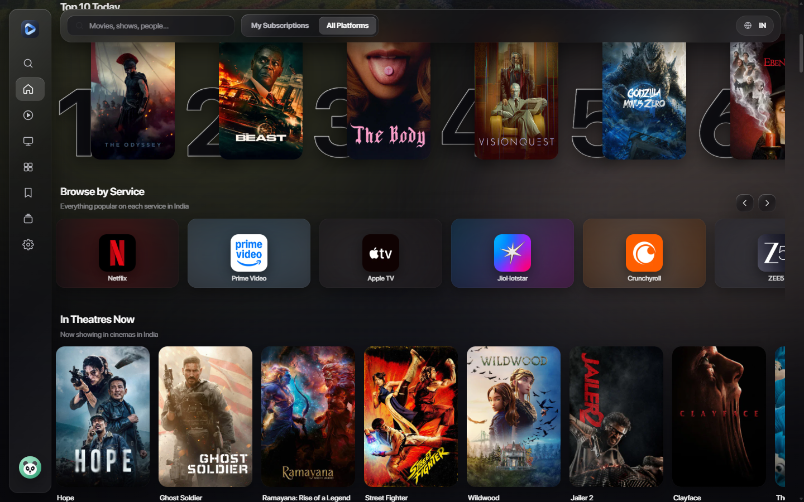
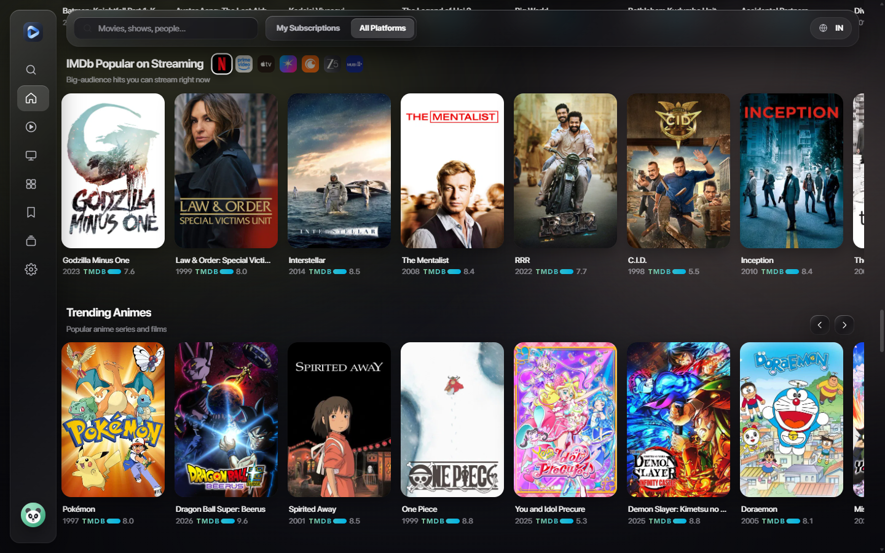
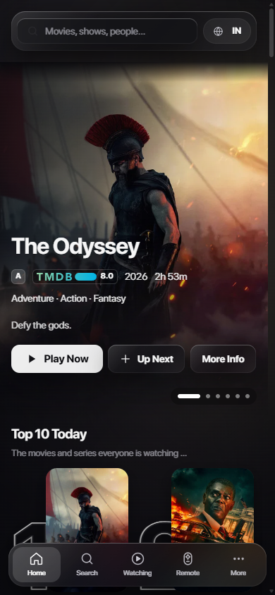

<p align="center">
  <picture>
    <source media="(prefers-color-scheme: dark)" srcset="src/assets/omnia-wordmark.png">
    <source media="(prefers-color-scheme: light)" srcset="assets/app-icon-with-text.png">
    
  </picture>
</p>

<p align="center">
  <b>Every streaming service in one hub, with a recommendation engine that never leaves your PC.</b><br>
  Netflix · Prime Video · JioHotstar · ZEE5 · Sony LIV · Apple TV+ · Disney+ · Max · Hulu · Peacock · and more
</p>

<p align="center">
  <a href="https://github.com/aryannaik225/Omnia/releases/latest"></a>
  
  
  
  
  
  
  
  
</p>

<p align="center">
  
</p>

Omnia brings every streaming service into one Apple TV–style catalog. It comes in three parts:

- **Omnia Desktop (Windows)** is the full app. It finds where a title streams in your region, opens the **exact** page on that service in a built-in DRM-capable player, remembers your position to the second on every service, and recommends what to watch next with a machine-learning engine that runs **entirely on your machine**.
- **Phone & TV companion.** A PIN-paired server on your own Wi-Fi serves the same app to phones, tablets and an Android TV client, and turns your phone into a remote. No cloud involved.
- **[Omnia on the web](https://omnia-tv.vercel.app/app)** is the same interface in any browser, as a manual tracker: mark movies and episodes watched, keep a watchlist, follow upcoming releases. Guest mode needs no account.

> **Privacy is the architecture, not a setting.** On the desktop, profiles, watch history, taste vectors and streaming sign-ins live in a local SQLite file and WebView2's own per-profile storage. There's no analytics and no telemetry, and no account is needed. Cloud sync is **opt-in**: it does nothing until you sign in, and even then it carries only your watchlist, watched titles, Home layout and profile name and picture.

**[Download for Windows](https://github.com/aryannaik225/Omnia/releases/latest)** · **[Website](https://omnia-tv.vercel.app)** · **[Open the web app](https://omnia-tv.vercel.app/app)** · Not a developer? See **[setup_instructions.txt](setup_instructions.txt)** for a plain-English install guide.

---

## Contents

- [Screenshots](#screenshots)
- [Highlights](#highlights)
- [Architecture](#architecture)
  - [Overview](#overview)
  - [React frontend](#react-frontend)
  - [Deep-link resolution](#deep-link-resolution)
  - [Smart player & telemetry](#smart-player--telemetry)
  - [ML engine: composite vectors + K-Means](#ml-engine-composite-vectors--k-means)
  - [Axum LAN companion server](#axum-lan-companion-server)
  - [Optional cloud sync](#optional-cloud-sync)
  - [Omnia on the web](#omnia-on-the-web)
  - [Local data](#local-data)
- [Privacy model](#privacy-model)
- [Getting started (developers)](#getting-started-developers)
- [Project structure](#project-structure)
- [Development guide](#development-guide)
- [Releasing](#releasing)
- [Troubleshooting](#troubleshooting)
- [Known limitations](#known-limitations)
- [Contributing](#contributing)
- [License](#license)

---

## Screenshots

| Top 10 Today & Browse by Service | IMDb Popular on Streaming (per-service filter) |
|---|---|
|  |  |
| **Title page** | **"View More" full-page grid** |
|  |  |

<p align="center">
  <br>
  <sub>The same app on a phone, served by the PC's LAN companion server</sub>
</p>

---

## Highlights

- **One catalog, your region.** TMDB-powered browsing with regional availability, a VPN-friendly region switcher and a **My Subscriptions** filter that hides anything you'd have to rent or buy.
- **A curated Home you can rearrange.** Continue Watching, *Top 10 Today*, franchise hubs, *Browse by Service*, In Theatres, critic and "IMDb-style" rows, personal rows (*Because you liked…*, *Your Next Watch*, *We Think You'll Love These*) and themed rows. Reorder everything below *Browse by Service* in **Settings → Home Page Layout**; the order is saved per profile and syncs when you're signed in.
- **Exact Play buttons.** Deep links to the exact title on each service, resolved through JustWatch, cached for 7 days, with a search-page fallback so Play never dead-ends.
- **A real player.** A chromeless WebView2 window (Widevine / PlayReady) with an injected observer that tracks position, pauses, seeks and in-app episode hops. A global hotkey and a glass pill take you back to the hub at the exact scroll position.
- **Cross-service history.** One-click import of past viewing (Netflix, Prime Video, JioHotstar and others) plus a background delta sync, so an episode watched in your phone's Netflix app lands in Continue Watching. **Mark as Watched** covers the cinema, a local file or another device.
- **My Library.** A Watch Summary (total days watched, movies, episodes) above Watchlist, Upcoming, Ongoing Series, Completed Series and Tracked Movies.
- **Release-aware title pages.** Titles that aren't streaming yet show their digital release date with a countdown, *In Theatres Now*, *Releasing today* or *Just released* instead of a dead end.
- **On-device recommendations.** Composite "vibe" vectors, K-Means taste clusters, and nearest-neighbour "More Like This" on every title page.
- **Family profiles that never mix.** Separate history, taste, kids mode and even separate streaming sign-ins per profile.
- **Phones & TVs without a cloud.** A PIN-paired LAN server on port 8765 serves the full app to any browser on your Wi-Fi; your phone can also act as a remote.
- **Optional sync with the web.** Sign in with email or Google to keep one profile's library in step between Omnia Desktop and Omnia on the web.

---

## Architecture

### Overview

```
┌──────────────────────────────── Omnia (Tauri 2, Windows) ────────────────────────────────┐
│                                                                                           │
│  Catalog window — React 19 + TS            Player / importer windows — WebView2           │
│  ┌────────────────────────────────┐        ┌────────────────────────────────────────┐    │
│  │ Zustand stores · TMDB client   │ events │ netflix.com / primevideo.com / …       │    │
│  │ Home row registry · Liquid     │◄───────┤ + injected telemetry observer + pill   │    │
│  │ Glass UI · lazy rows           │        │   (per-profile data directory)         │    │
│  └───────────────┬────────────────┘        └──────────────────┬─────────────────────┘    │
│                  │ typed IPC (deny-by-default ACL)             │ 5 token-gated commands  │
│  ┌───────────────▼─────────────────────────────────────────────▼─────────────────────┐   │
│  │ Rust backend                                                                       │   │
│  │  db/        SQLite (rusqlite, WAL) + numbered migrations                           │   │
│  │  resolver/  JustWatch GraphQL deep links · 7-day cache · fallback URLs             │   │
│  │  player/    window manager · profile attribution · global hotkeys                  │   │
│  │  sync/      history importer · delta sync · airing checks · opt-in cloud sync      │   │
│  │  ml/        ONNX embeddings · composite vectors · K-Means · MMR · nearest neighbour│   │
│  │  lan/       axum companion server :8765 · UDP discovery :8766 · PIN pairing        │   │
│  └──────────────────────────────┬─────────────────────────────────────┬──────────────┘   │
└─────────────────────────────────┼─────────────────────────────────────┼──────────────────┘
                                  │ only after you sign in              │ your Wi-Fi only
                  Supabase (RLS) ⇄ Omnia on the web (/app)   iPhone Safari · any browser · Android TV
```

| Layer | Technology |
|---|---|
| Desktop shell & backend | Tauri 2, Rust, Tokio |
| Desktop frontend | React 19, TypeScript, Vite, Tailwind CSS, Framer Motion, Zustand |
| Storage | SQLite via `rusqlite` / `tokio-rusqlite` (WAL) |
| ML | ONNX Runtime via `ort` (loaded dynamically), `all-MiniLM-L6-v2` (uint8), custom vector maths in Rust |
| Networking | `reqwest` (rustls), JustWatch GraphQL, TMDB REST |
| LAN server | `axum` |
| Website & web app | Next.js (App Router) on Vercel, React Three Fiber landing page |
| Optional sync | Supabase (Postgres + RLS, Auth with email and Google, Storage, Realtime) |

### React frontend

- **Home row registry** (`src/config/homeRows.ts`): every catalog row maps to one TMDB query, and the same entry backs that row's full-page **View More** grid, so a row and its grid never disagree. "IMDb" / "Rotten Tomatoes" rows are honest approximations from TMDB popularity, vote average and vote count.
- **Home Page Layout** (`src/config/homeLayout.ts`): the default order and ids of the reorderable rows. It's identical in `src/` and `web-export/omnia/` because the order syncs between the two.
- **Regional blend:** outside the US, global rows reserve 3 of every 10 slots for titles produced in your region (`with_origin_country`). It's a soft target: if regional data runs short, global titles fill the gaps.
- **Release status** (`src/lib/releaseStatus.ts`, shared verbatim with the web app): turns TMDB's regional release dates into the title page's release card.
- **Performance:** rows mount and fetch only as they approach the viewport (`IntersectionObserver`), TMDB responses are cached in memory with in-flight de-duplication, secondary screens are code-split, and Back restores the exact scroll position.
- **Liquid Glass design system** (`src/styles/liquid-glass.css`): refractive blur, specular borders, ambient colour bleed sampled from the focused artwork, and 3D specular hover on cards.
- **One UI, three transports** (`src/services/platform.ts`): in-process Tauri IPC on the desktop, same-origin HTTP in a phone browser, and HTTP + bearer token in the Android TV thin client.
- **No keys in the bundle:** the UI reaches TMDB only through the Rust `tmdb_get` command, which adds the key.

### Deep-link resolution

1. TMDB provides catalog data and *which* services carry a title in your region.
2. `resolver/justwatch.rs` queries JustWatch's public GraphQL API with the title, year, type and region, and extracts the exact `standardWebURL` for each service (`netflix.com/title/…`, `hotstar.com/in/movies/…`, `primevideo.com/detail/…`).
3. Results are cached in the `deep_links` table for **7 days**, so later clicks are instant.
4. If no direct link exists, a deterministic search URL for that service is used (e.g. `netflix.com/search?q=…`), so Play never fails.
5. Episodes open as the episode itself (`netflix.com/watch/<episode>`). Phones get a tap-to-open Universal Link; the Android TV client hands Play to the installed app with an Android intent (`nflx://…`).

### Smart player & telemetry

- **Play** opens a chromeless WebView2 `WebviewWindow` on the resolved link, with its own data directory per Omnia profile (`Profiles/<id>`), so family members never share a streaming session.
- An injected observer (`player/telemetry_injector.js`) hooks the real `<video>` element: position and duration every ~3 s, actual watch time (paused or buffering time excluded), seeks, and title / season / episode hops inside the service.
- **Profile attribution:** the service's active profile (e.g. Netflix's `guid`) is compared with the profile you linked. **Nothing is recorded unless they match.**
- **Back to Hub:** `Ctrl+Shift+O` / `Ctrl+Shift+H` or the frosted pill flushes the final position, closes the player and returns to the catalog.
- **Security:** every backend command is deny-by-default. Player windows can reach only five commands, only from known streaming domains, and every call must carry a per-session secret.

### ML engine: composite vectors + K-Means

All of this runs in Rust on your PC (`src-tauri/src/ml/`).

**1. Behavioural affinity per title.** Completion **+1.0**, rewatch ("Comfort Favorite") **+2.0**, Love **+3.0**, binge (3+ episodes in a sitting) **×1.8**, early abandonment **−0.8**, plus partial progress, watchlist intent, engagement and skimming, decayed with a 120-day half-life and bucketed by time of day.

**2. Composite "vibe" vector per title.** A single plot embedding misses what a film *feels* like, so every title is built from four blocks, each normalised on its own and scaled by √weight before concatenation:

| Block | Weight | How it's encoded |
|---|---:|---|
| TMDB keywords (*cyberpunk, time loop, dark comedy*) | **40%** | hashed exact keywords + their words, plus a sentence embedding of the keyword list |
| Auteur: director(s) + top 3 billed cast | **25%** | hashed "person" space (an actor-director matches across roles) |
| Genre taxonomy | **20%** | one-hot over TMDB genres (TV's *Sci-Fi & Fantasy* maps onto *Science Fiction* + *Fantasy*) |
| Semantic plot | **15%** | `all-MiniLM-L6-v2` embedding of the overview (hashed TF fallback) |

Because each block is unit-length and scaled by √weight, the similarity of two titles is **exactly**

```
a · b = 0.40·cos(keywords) + 0.25·cos(auteur) + 0.20·cos(genres) + 0.15·cos(plot)
```

and a block a title lacks contributes 0 instead of being renormalised upward. (On real data: *Blade Runner* → *Ghost in the Shell* 0.33 vs *Notting Hill* 0.14; *Groundhog Day*'s nearest neighbours are *Palm Springs* and *Edge of Tomorrow*.)

**3. "We Think You'll Love These": K-Means taste clusters.** Averaging everything you like produces a "vector smoothie" that matches nothing. Instead, Omnia runs **weighted spherical K-Means** (K-Means++ seeding, deterministic per profile, best of several restarts) over your liked / watched titles:

| Titles with positive affinity | K |
|---|---|
| up to 10 | 1 |
| 11–30 | 2 |
| more than 30 | 3 |

Each centroid (minus a push away from disliked titles) gets its own nearest-neighbour search with its own tone, and the results are **interleaved in proportion to cluster mass** (e.g. 7 / 7 / 6 → A B C A B C …). The row subtitle names each side of your taste.

**4. "More Like This" on every title page.** A single-title nearest-neighbour search over every title already embedded locally (`title_vectors`), with MMR for variety, followed by TMDB's own recommendations in their order. It's a sub-second fast path: nothing is embedded on the fly except the title itself, once.

**5. Ranking & diversity.** Dot product against a unit query, a tone-clash penalty (no serial-killer thrillers in a cosy-comedy row), and **Maximal Marginal Relevance** so rows stay varied. Rows come with explanations: *"Because you binged Stranger Things late at night"*.

The model (~23 MB) and ONNX Runtime are downloaded once, pinned to exact versions and SHA-256 verified. ONNX Runtime is loaded at runtime rather than linked, so a missing runtime can never stop Omnia from starting; a hashing fallback keeps recommendations working offline. ONNX telemetry is disabled.

### Axum LAN companion server

Off by default; turn it on in **Settings → Linked Devices**.

- `lan/mobile_server.rs` serves the built React app and `POST /api/invoke/{command}` on **`0.0.0.0:8765`**: an **allow-list** bridge to desktop commands. Paired devices can browse, edit their library and mark things watched, but can't delete profiles, wipe history, link accounts, open the PC's player or change LAN or sync settings.
- **Pairing:** a **6-digit PIN** or **QR code** (10-minute lifetime, rotated after every pairing and after 5 wrong guesses). Browsers get an `HttpOnly; SameSite=Lax` cookie, the TV app a bearer token. Only a SHA-256 hash of each device's token is stored, and any device can be revoked.
- **Hardening:** requests whose `Host` isn't an IP literal, `localhost` or `.local` are refused (DNS rebinding), and so are cross-site requests (except the TV app's own origin).
- **Discovery:** UDP **8766** answers `OMNIA_DISCOVER` with the PC's name and port only.
- **Phone as a remote:** the phone's Remote tab sends D-pad / OK / Back / Play-Pause to the PC (`/api/remote/send`) or to a TV (long-poll `/api/remote/poll`).
- **Android TV:** a thin-client build of the same frontend (`npm run build:tv`) with no database of its own. See [docs/PHONE_AND_TV.md](docs/PHONE_AND_TV.md).

### Optional cloud sync

Off by default. **Settings → Sign in to Sync** (email + password, or Google via a one-shot `127.0.0.1:54365` loopback) links **one** local profile to a Supabase account.

- **Synced:** watchlist, watched movies and episodes (including what the player and importer recorded), Home Page Layout, profile name and a 256×256 WebP picture.
- **Never synced:** streaming-service cookies and sessions, playback telemetry, taste vectors, caches, other profiles.
- **How:** SQLite triggers (migrations v9–v10) queue changes in `cloud_outbox`; `sync/cloud.rs` pushes them with each change's `updated_at`, deletions as tombstones, and pulls by server `synced_at`. The server keeps the newest write per item.
- **Signed out = zero Supabase requests.** The project URL and *anon* key are compiled in by `build.rs`, which refuses a secret / service-role key.

Setup, schema and the privacy boundary: [docs/CLOUD_SYNC.md](docs/CLOUD_SYNC.md).

### Omnia on the web

`web-export/` is a separate Next.js project deployed to Vercel:

- **`/`** is the landing page (static, hourly ISR). It reads the latest GitHub release on the server and serves `/download/exe` and `/download/msi` redirects to the installers.
- **`/app`** is the desktop frontend ported into `web-export/omnia/` (same layout as `src/`) as a manual tracker. **Guest mode** keeps the library in `localStorage`. Signing in with email or Google is optional, merges the guest library, and syncs live with the desktop. TMDB is reached through a server-side proxy, so the key never ships to the browser.
- **`/privacy`** and **`/terms`** are the legal pages.

Desktop-only features (player, OTT import, recommendations, LAN pairing) show an "Available on Omnia Desktop" badge. See [web-export/README.md](web-export/README.md).

### Local data

| What | Windows location |
|---|---|
| Database | `%APPDATA%\app.omnia.hub\omnia.db` |
| Models & ONNX Runtime | `%APPDATA%\app.omnia.hub\models\` |
| Logs | `%LOCALAPPDATA%\app.omnia.hub\logs\` |
| Per-profile browser data (service sign-ins) | `%LOCALAPPDATA%\app.omnia.hub\Profiles\<profile id>\` |

21 tables, created by `src-tauri/src/db/schema.sql` plus the numbered migrations in `src-tauri/src/db/migrations/` (v2–v10, run automatically on startup).

---

## Privacy model

| Data | Where it lives | Leaves your machine? |
|---|---|---|
| Profiles, watch history, playback events, collections, favourites | Local SQLite | **Never** |
| Taste vectors, clusters, recommendation scores | Local SQLite, computed on-device | **Never** |
| Streaming-service cookies and sign-ins | WebView2's store, one folder per Omnia profile; Rust never reads them | Only to that service's own website |
| Watchlist, watched titles, Home layout, profile name & picture | Local SQLite | Only if you sign in to sync, to Supabase (RLS: only your account can read it) |
| Your library, read by a paired phone / TV | Stays in the PC's SQLite | Only to devices you paired, over your local network |
| Title names for metadata / link lookups | n/a | Sent to TMDB and JustWatch as anonymous public strings |

The desktop app's only outbound calls: **TMDB** (catalog metadata and artwork), **JustWatch GraphQL** (title → link), **ipwho.is / ip-api.com** (one-time region detection, overridable), **GitHub** (signed updates), **Hugging Face / Microsoft's GitHub releases** (one-time verified model + runtime download), **youtube-nocookie.com** (trailers; autoplay can be turned off), **the streaming services themselves**, and **Supabase** only while signed in to sync.

The user-facing policy is [`/privacy`](web-export/app/privacy/page.tsx) on the website.

---

## Getting started (developers)

### Prerequisites

| Tool | Version |
|---|---|
| Windows | 10 or 11 (WebView2 ships with Windows 11; the installer bootstraps it on 10) |
| [Node.js](https://nodejs.org/) | 20+ (CI uses 22) |
| [Rust](https://rustup.rs/) | stable, MSVC toolchain |
| [Visual Studio Build Tools](https://visualstudio.microsoft.com/visual-cpp-build-tools/) | "Desktop development with C++" |
| [TMDB API key](https://www.themoviedb.org/settings/api) | v3 key **or** v4 read access token |
| [Supabase](https://supabase.com/) project | optional, only for cloud sync / web sign-in |

### Desktop app

```sh
git clone https://github.com/aryannaik225/Omnia.git
cd Omnia
npm install

cp .env.example .env          # set TMDB_API_KEY; leave SUPABASE_* empty for a 100% local build
npm run tauri dev
```

The repo-root `.env` is read at **build time** by `src-tauri/build.rs` and compiled into the Rust binary only. Nothing in it reaches the JS bundle (Vite only exposes `VITE_OMNIA_*`):

| Variable | Required | Purpose |
|---|---|---|
| `TMDB_API_KEY` | yes | Public catalog metadata. Without it, users must paste a key in Settings. |
| `SUPABASE_URL` | no | `https://<project-ref>.supabase.co`. Empty = cloud sync disabled. |
| `SUPABASE_ANON_KEY` | no | The **anon / publishable** key. The build fails on a secret / service-role key. |

The first `tauri dev` compiles the Rust backend (a few minutes); later starts are fast. On first launch Omnia creates its database, detects your region, and downloads the recommendation model in the background.

### Website & web app (`web-export/`)

```sh
cd web-export
npm install
cp .env.example .env.local    # fill in the values below
npm run dev                   # http://localhost:3000 (landing) and /app (web app)
```

| Variable | Exposure | Purpose |
|---|---|---|
| `NEXT_PUBLIC_SUPABASE_URL`, `NEXT_PUBLIC_SUPABASE_ANON_KEY` | public (browser) | Sign-in and sync. Without them `/app` runs in guest mode only. |
| `NEXT_PUBLIC_SITE_URL` | public | The deployment URL (auth redirects). |
| `TMDB_API_KEY` | server only | Used by the `/app/api/tmdb` proxy and the landing page's artwork. |
| `GITHUB_TOKEN` | server only, optional | Raises the GitHub API limit for the landing page's release lookup. |

The landing page builds and runs with none of these set.

### Supabase (optional)

1. Create a project, open the **SQL editor** and run [`supabase/schema.sql`](supabase/schema.sql). It's idempotent, so re-run it after pulling schema changes.
2. Enable the Email and (optionally) Google providers, and add the redirect URLs: `https://<your-site>/app/auth/callback`, `http://localhost:3000/app/auth/callback` and `http://127.0.0.1:54365/auth/callback` (desktop Google sign-in).
3. Put the project URL and **anon** key in `.env` (desktop) and `web-export/.env.local` (web).

Full walkthrough: [docs/CLOUD_SYNC.md](docs/CLOUD_SYNC.md).

### Build the installer

```sh
npm run tauri build
```

| Output | Path |
|---|---|
| NSIS installer (recommended) | `src-tauri/target/release/bundle/nsis/Omnia_<version>_x64-setup.exe` |
| MSI | `src-tauri/target/release/bundle/msi/Omnia_<version>_x64_en-US.msi` |
| Bare executable | `src-tauri/target/release/omnia.exe` |

Local builds aren't signed for the auto-updater unless `TAURI_SIGNING_PRIVATE_KEY` is set; official releases are built by CI (see [Releasing](#releasing)).

---

## Project structure

```
├── src/                              React 19 + TypeScript desktop frontend
│   ├── App.tsx                       shell: boot → "Who's watching?" → catalog, routing, scroll restore
│   ├── config/
│   │   ├── homeRows.ts               Home row registry: TMDB mappings, regional blend, View More sources
│   │   ├── homeLayout.ts             reorderable Home rows (shared with web-export/omnia)
│   │   └── hubsRegistry.ts           franchise / studio / originals hubs
│   ├── components/
│   │   ├── home/                     HeroBillboard, ContinueWatchingRow, HomeRows, BrandHubsRow, MediaCarouselRow
│   │   ├── views/                    Home, Library, BrowseCategoryView (View More), Search, Watching Now, Hubs…
│   │   ├── library/                  useLibrary: history + watchlist joined with TMDB summaries
│   │   ├── modals/                   MediaDetailModal (release card, More Like This), AccountSyncModal, OttPicker…
│   │   ├── settings/                 SettingsView, CloudSyncSection, LinkedDevices (PIN, QR, revoke)
│   │   ├── tv/                       TV discovery / pairing, on-screen keyboard
│   │   └── common/                   cards, grid, icons, HomeLayoutEditor…
│   ├── lib/                          hooks, personal signals, releaseStatus, provider families, spatial nav
│   ├── services/                     tauriBridge (typed IPC), platform transport, tmdbClient, librarySummary
│   ├── store/                        Zustand: useAppStore, usePlayerStore
│   └── styles/liquid-glass.css       design tokens & glass components
│
├── src-tauri/                        Rust backend
│   ├── build.rs                      command manifest (deny-by-default ACL), compile-time keys + secret guards
│   ├── capabilities/, permissions/   per-window permissions
│   └── src/
│       ├── desktop.rs                state, command registration, hotkeys, tray
│       ├── db/                       connection, schema.sql, migrations (v2–v10), queries
│       ├── resolver/justwatch.rs     deep-link resolver
│       ├── player/                   window_manager.rs, telemetry_injector.js
│       ├── sync/                     history importer, background delta sync, airing checks, cloud.rs (opt-in)
│       ├── ml/                       embeddings.rs (composite vectors), recommender.rs (K-Means, NN, MMR)
│       ├── lan/mobile_server.rs      axum LAN companion server
│       └── tv_client.rs              Android TV thin client (discovery + intents)
│
├── web-export/                       Next.js website: landing page (/), web app (/app), /privacy, /terms
│   └── omnia/                        the desktop frontend, ported (same layout as src/)
├── supabase/schema.sql               idempotent Supabase schema (RLS, avatars bucket, keep_alive)
├── docs/                             CLOUD_SYNC.md, PHONE_AND_TV.md, screenshots
├── .github/workflows/                release.yml (tag → signed installers), supabase-keep-alive.yml
└── setup_instructions.txt            plain-English install guide, attached to every release
```

---

## Development guide

```sh
npm run tauri dev               # desktop app with hot reload
npm run build                   # type-check + desktop frontend production build
cd src-tauri && cargo test      # backend unit tests (signals, composite vectors, K-Means, sync, isolation…)
cd web-export && npm run build  # type-check + Next.js production build
```

See [CONTRIBUTING.md](CONTRIBUTING.md) for the full checklist before opening a PR.

**Real ONNX quality test** (skipped by default): point it at a model folder and an ONNX Runtime DLL.

```sh
OMNIA_MODEL_DIR=%APPDATA%/app.omnia.hub/models/all-MiniLM-L6-v2 \
OMNIA_ORT_DLL=%APPDATA%/app.omnia.hub/models/onnxruntime-1.31.0/onnxruntime.dll \
cargo test onnx_model_end_to_end -- --nocapture
```

### Adding a Home row
1. Add a `case` to `resolveRow` in `src/config/homeRows.ts` (title, subtitle, whether the query applies the subscription filter itself, and a paged loader). Its View More grid works automatically.
2. **Append** a slot with the same id to `HOME_SLOTS` in `src/config/homeLayout.ts`, and copy the file to `web-export/omnia/config/homeLayout.ts`. Never rename or reuse an id: saved layouts reference them.

### Adding a hub
Add an entry to `HUB_REGISTRY` in `src/config/hubsRegistry.ts`; it is seeded into `custom_hubs` on startup.

```ts
hub("a24", "A24", "studio", {
  movie: { with_companies: "41077" },
  tv: { with_companies: "41077" },
  tagline: "Bold, singular cinema",
  theme: { from: "#111111", to: "#2d2d2d", accent: "#ffffff" },
}),
```

### Adding a backend command
1. Add a `#[tauri::command]` and register it in `generate_handler!` (`src-tauri/src/desktop.rs`).
2. Add its name to `COMMANDS` in `src-tauri/build.rs`.
3. Grant `allow-<command-name>` in `src-tauri/permissions/omnia.toml`.
4. Add a typed wrapper to `src/services/tauriBridge.ts`.
5. To expose it to paired phones / TVs, add it to the allow-list in `src-tauri/src/lan/mobile_server.rs`.

### Changing shared UI or the sync schema
- `web-export/omnia/` mirrors `src/`; port UI changes to both. `lib/releaseStatus.ts` and `config/homeLayout.ts` are kept identical.
- Schema changes go in a new numbered migration (`src-tauri/src/db/migrations/`) and, for synced data, in `supabase/schema.sql` (idempotent), `sync/cloud.rs`, `docs/CLOUD_SYNC.md` and the privacy page.

---

## Releasing

Releases are built by [`.github/workflows/release.yml`](.github/workflows/release.yml) on a version tag. The full checklist (every file to bump, docs parity, build checks, secrets, publishing) is **[docs/RELEASING.md](docs/RELEASING.md)**; in short:

1. Bump the version in `package.json`, `src-tauri/tauri.conf.json` and `src-tauri/Cargo.toml` (then `cargo check` to refresh `Cargo.lock`). The workflow fails if the tag and these disagree.
2. Commit, then `git tag vX.Y.Z && git push origin vX.Y.Z`.
3. CI builds the NSIS and MSI installers, signs the updater artifacts, publishes the GitHub Release with `latest.json` (which installed copies poll for updates) and attaches `setup_instructions.txt`.
4. Edit the release on GitHub to paste the release notes. The landing page shows them within an hour.

Repository secrets: `TMDB_API_KEY` and `TAURI_PRIVATE_KEY` (required), `TAURI_KEY_PASSWORD`, and `SUPABASE_URL` / `SUPABASE_ANON_KEY` (optional; without them the release ships with sync disabled, and they're also used by the keep-alive workflow).

---

## Troubleshooting

| Symptom | What to check |
|---|---|
| "Connect TMDB to start browsing" | `TMDB_API_KEY` missing from `.env` at build time. Rebuild / restart `tauri dev`, or paste a key in Settings. |
| Recommendations use the offline fallback | Look for `ONNX embeddings unavailable…` in the logs; the one-time download retries on next launch. |
| "More Like This" shows mostly TMDB picks | Normal on a fresh install: local matches come from titles already embedded, which grows as you browse and as recommendations refresh. |
| The player pill stays orange | The service is on a different or unlinked profile. Switch profiles in the service, or click **Link to *you*** in the pill. |
| A phone / TV can't connect | Linked Devices must be on; allow Omnia on **private networks** (TCP 8765, UDP 8766); same Wi-Fi (not a guest network). In `tauri dev`, run `npm run build` once so the LAN server has `dist/` to serve. |
| A hotkey doesn't work | Another app may own it (`could not register global shortcut` in the logs). The other hotkey and the pill still work. |
| "Sign in to Sync" is missing or sync is disabled | The build had no `SUPABASE_URL` / `SUPABASE_ANON_KEY`. Set them in `.env` and rebuild. |
| Settings says "re-run supabase/schema.sql" | The Supabase schema is older than the app. Re-run `supabase/schema.sql` (safe to repeat). |
| Google sign-in on the desktop never returns | Add `http://127.0.0.1:54365/auth/callback` to Supabase's Redirect URLs, and make sure nothing else uses port 54365. |

---

## Known limitations

- **Undocumented service internals.** Player data, viewing-activity endpoints and history pages aren't public APIs and can change; each service is isolated in an adapter with fallbacks.
- **Automatic profile switching is Netflix-only.** Other services are verified (wrong-profile viewing is never recorded), but you switch profiles yourself.
- **IMDb / Rotten Tomatoes rows are approximations** built from TMDB data; only TMDB ratings are shown. 4K HDR / Atmos and "Leaving Soon" aren't available from TMDB.
- **Windows only** for the desktop app (WebView2 player, ONNX Runtime auto-download for x64).
- **Phones and TVs need the PC running** and can't link accounts or import history themselves. The Android TV build hasn't been tested on a device yet.
- **The web app is a manual tracker:** no player, no automatic history, no recommendations.
- **Cloud sync covers one desktop profile per account** and syncs the library, not playback progress.

---

## Contributing

Bug reports, provider fixes, new hubs and PRs are welcome. Start with [CONTRIBUTING.md](CONTRIBUTING.md). [CLAUDE.md](CLAUDE.md) is the detailed design spec for every module.

---

## License

[MIT](LICENSE) © 2026 Aryan Naik

This product uses the TMDB API but is not endorsed or certified by TMDB. Streaming service names are trademarks of their respective owners; Omnia is not affiliated with them.
